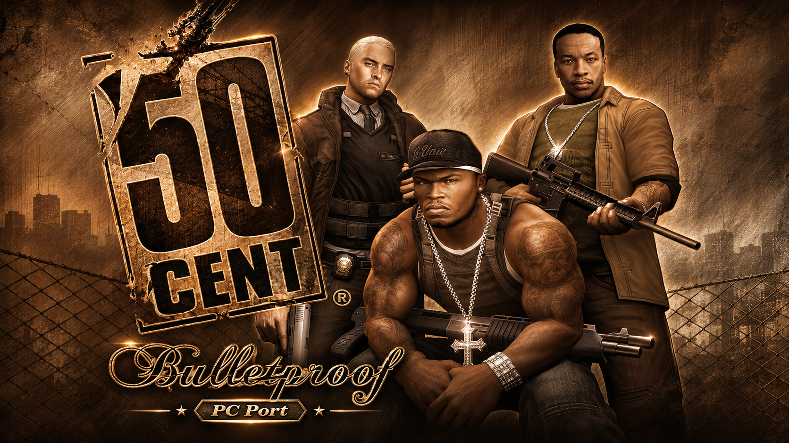
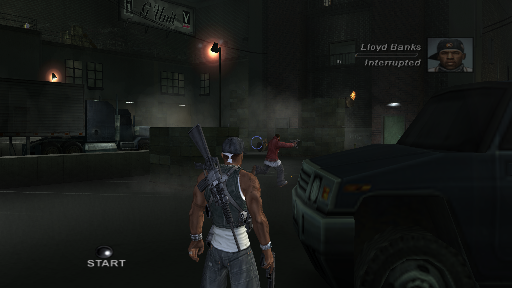

# 50 Cent: Bulletproof PC Port

Play *50 Cent: Bulletproof* on modern PCs with **4K resolution, up to 120 FPS, widescreen support and mouse and keyboard controls**.

An unofficial native PC port of the original Xbox game for Windows and Linux, powered by Vulkan. No emulator required.

## Features

- **Native PC port:** Available on Windows and Linux.
- **Vulkan renderer:** High-resolution rendering with adjustable 3D render scale and VSync.
- **Up to 120 FPS:** Select between 30, 60, 90 and 120 FPS, with game timing adapted for higher frame rates.
- **Up to 4K:** Eight resolution presets across widescreen (16:9) and classic (4:3) aspect ratios.
- **Mouse and keyboard:** Mouse aiming, adjustable sensitivity, remappable controls and updated input prompts.
- **Controller support:** Play with an Xbox controller.
- **Display modes:** Windowed, borderless and fullscreen.
- **Audio and gameplay improvements:** Adapted audio playback, input and gameplay timing for modern PCs.
- **Automatic recompilation:** Game code is prepared automatically on first launch.
- **Portable and offline:** No installer, external compiler or internet connection required to play.

## Supported resolutions

| Preset | Widescreen (16:9) | Classic (4:3) |
| --- | ---: | ---: |
| 720p | 1280 × 720 | 960 × 720 |
| 1080p | 1920 × 1080 | 1440 × 1080 |
| 1440p | 2560 × 1440 | 1920 × 1440 |
| 2160p | 3840 × 2160 | 2880 × 2160 |

## Download and installation

Get the latest available build from [GitHub Releases](https://github.com/Atecep/50Cent-Bulletproof-PC-Port/releases).

1. Download the Windows `.zip` or Linux `.tar.xz` package.
2. Extract the archive to a writable folder.
3. Place your supported original Xbox game ISO inside the `assets/` folder.
4. Launch `Bulletproof.exe` on Windows or `./Bulletproof` on Linux.
5. Allow the game to finish its automatic first-launch preparation.

Subsequent launches reuse the compiled game files. Saves, settings and the compiled game are stored locally in `userdata/`. Keep this folder when moving or updating your installation.

**You must provide your own supported copy of the game. No original game files are included.**

## System requirements

| Component | Requirement |
| --- | --- |
| Windows | Windows 11 (64-bit) |
| Linux | 64-bit Linux with glibc 2.35 or newer (Ubuntu 22.04 baseline) |
| CPU | x86-64-v2 compatible processor |
| GPU | Vulkan 1.2 support and compatible graphics drivers |

Linux also requires the system C++ runtime, zlib, a Vulkan loader and a desktop session. Performance and available fullscreen modes depend on your hardware, operating system and display.

See the [supported disc revision](docs/BUILDING.md#portable-host-without-game-assets) and [build documentation](docs/BUILDING.md) for technical details.

## Compatibility and known issues

The port has been tested through the opening campaign gameplay on Windows and Linux. The full campaign has not yet been validated, and other disc revisions are not currently validated.

Community testing is welcome. Report bugs, installation problems and campaign compatibility through [GitHub Issues](https://github.com/Atecep/50Cent-Bulletproof-PC-Port/issues). For installation issues, include a short, redacted excerpt from `userdata/logs/`. Do not upload game files, generated code or saves.

[Campaign Compatibility Tracker](docs/CAMPAIGN_COMPATIBILITY.md) · [Known Issues](docs/KNOWN_ISSUES.md)

## Credits and license

Thanks to the original developers of *50 Cent: Bulletproof* and the contributors who made this project possible.

This port builds on [XboxXBERecomp](https://github.com/TGP482/XboxXBERecomp) by TGP482, which credits [XenonRecomp](https://github.com/hedge-dev/XenonRecomp) for its function layout and hook design.

The port's own contributions are released under the [MIT License](LICENSE). Third-party components retain their respective licenses. See [Third-Party Notices](THIRD_PARTY_NOTICES.md) and [Licensing](docs/LICENSING.md).

This is an independent fan project and is not affiliated with or endorsed by the game's rights holders. All rights to the original game and trademarks belong to their respective owners.
